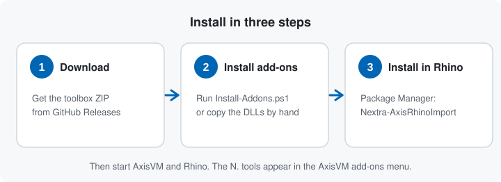
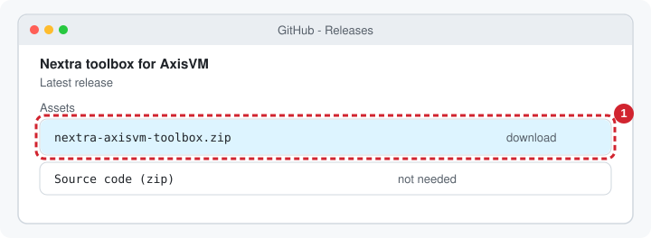
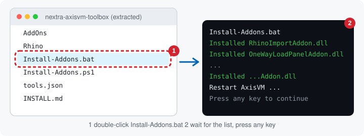
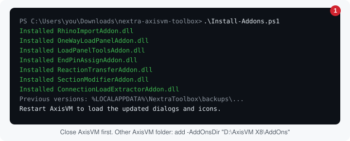
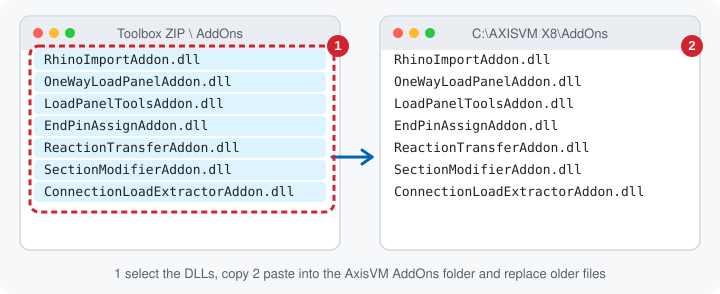
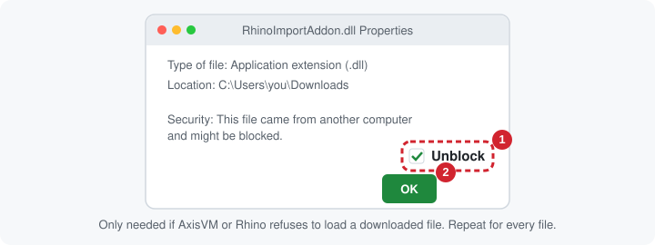
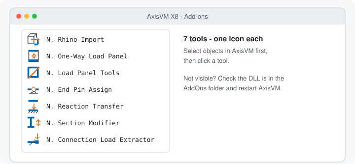
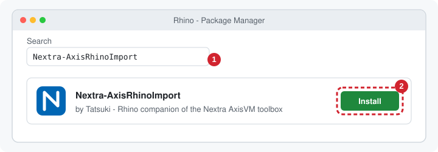
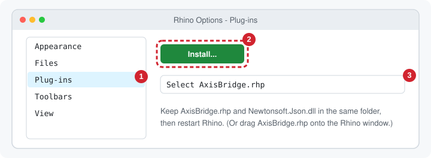

# Install the Nextra AxisVM toolbox

Windows | AxisVM X8 (.NET Framework 4.8) | Rhino 8.6 or newer for the Rhino plug-in. This page is also included in the download ZIP as `INSTALL.md`.



## 1. Download

Download **nextra-axisvm-toolbox.zip** from the repository's [Releases](https://github.com/nextra-studio/nextra-toolbox-axisvm/releases/latest) page and extract it. It contains `AddOns\` (the DLLs), `Rhino\` (the Rhino plug-in files), `Install-Addons.bat`, `Install-Addons.ps1`, `tools.json` and `INSTALL.md`.



## 2. AxisVM add-ons

Close every AxisVM window first, then choose one of three ways, easiest first. All end with the same files in the same folder.

### A. Double-click (easiest)

Open the extracted folder, **double-click `Install-Addons.bat`**, and wait for the list of installed DLLs. No PowerShell window or settings change needed.



- A blue **Windows protected your PC** box may appear for a downloaded file: click **More info**, then **Run anyway**.
- If AxisVM is not in `C:\AXISVM X8`, the script asks for your AddOns folder. You can also drag that folder onto `Install-Addons.bat`.
- If Windows needs administrator rights for the AxisVM folder, the window offers **Try again as administrator**.

### B. PowerShell

In the extracted folder open PowerShell and run:

```powershell
.\Install-Addons.ps1
# Different AxisVM location:
.\Install-Addons.ps1 -AddOnsDir 'D:\AxisVM X8\AddOns'
```



It reads the tool list from `tools.json`, verifies that every DLL is present, backs up existing toolbox DLLs to `%LOCALAPPDATA%\NextraToolbox\backups\<timestamp>`, copies the new ones and compares SHA-256 hashes. It does not delete other files or install vendor assemblies. `-WhatIf` previews. If execution policy blocks the script: `powershell -ExecutionPolicy Bypass -File .\Install-Addons.ps1`.

### C. Fallback: copy the DLLs yourself

1. Open the ZIP's `AddOns` folder and the AxisVM `AddOns` folder (normally `C:\AXISVM X8\AddOns`) side by side.
2. Copy these DLLs into the AxisVM folder, replacing older versions (optionally keep the old ones first):

<!-- gen:dll-list -->
- `RhinoImportAddon.dll`
- `OneWayLoadPanelAddon.dll`
- `LoadPanelToolsAddon.dll`
- `EndPinAssignAddon.dll`
- `ReactionTransferAddon.dll`
- `SectionModifierAddon.dll`
- `ConnectionLoadExtractorAddon.dll`
<!-- /gen:dll-list -->



3. If the copy is denied, use an Explorer window run as administrator.
4. If a tool does not load, right-click the DLL, choose **Properties**, tick **Unblock**, and restart AxisVM.



### Check

Start AxisVM. Each tool appears in the add-ons menu with its own icon. Select objects in AxisVM before opening a tool; see the [illustrated guide](user-guide/README.md).



## 3. Rhino plug-in: Nextra-AxisRhinoImport

### A. Package Manager (recommended)

In Rhino run `PackageManager`, search **Nextra-AxisRhinoImport**, click Install, restart Rhino.



Command line: `yak install Nextra-AxisRhinoImport` (`yak.exe` is in `C:\Program Files\Rhino 8\System`).

### B. Fallback: install the file yourself

Keep `AxisBridge.rhp` and `Newtonsoft.Json.dll` (the ZIP's `Rhino` folder) together. Unblock them if needed, then in Rhino choose Tools > Options > Plug-ins > Install..., select `AxisBridge.rhp` and restart Rhino. Dragging the `.rhp` onto the Rhino window also works.



Type `Ax` in the command line to see `AxPoint`, `AxLine`, `AxDomain`, `AxLibrary`, `AxEdgeHinge`, `AxVisualize`, `AxClear`, `AxUpdateGuid`, `AxLayerTidyUp` and `AxExport`.

## Update and roll back

- **Update:** repeat steps 2 and 3 with the newer ZIP.
- **Roll back AxisVM:** close AxisVM, copy the DLLs from the backup folder to `AddOns`, restart. A DLL loaded by a running process cannot be replaced reliably.
- **Roll back Rhino:** `PackageManager` > Installed > Uninstall, or `yak uninstall Nextra-AxisRhinoImport`.

## Build from source

Install the .NET 10 SDK (or a Visual Studio/MSBuild supporting `.slnx`) and the .NET Framework 4.8 targeting pack. The projects read the two AxisVM assemblies from your AxisVM folder.

```powershell
dotnet build 'AxisVM plugin\AxisVM plugin.slnx' -c Release -m:1
.\scripts\Install-Addons.ps1
# Different AxisVM installation:
dotnet build 'AxisVM plugin\AxisVM plugin.slnx' -c Release -m:1 '/p:AxisVMDir=D:\AxisVM X8'
.\scripts\Install-Addons.ps1 -AddOnsDir 'D:\AxisVM X8\AddOns'
```

Output: `AxisVM plugin\AxisVM plugin\bin\Release\`. To produce the download ZIP run `.\scripts\New-Release.ps1`; see [ADDING-A-TOOL.md](ADDING-A-TOOL.md).

## Troubleshooting

| Problem | Check |
|---|---|
| Build cannot find AxisVM references | Set `AxisVMDir` to the folder containing `Interop.AxisVM.FW4.dll` and `AxisVMDotNetAddonPluginInterface_v1.0.FW4.dll`. |
| Copy reports a locked DLL | Close every AxisVM process and retry. |
| Old dialog or icon remains | Confirm the DLL path, replace the DLL, restart AxisVM. |
| A tool is missing | Confirm its DLL is in `AddOns`, Unblock it, restart AxisVM. |
| A menu entry says (WIP) | Deliberate: the tool is new and not yet validated. |
| No `Ax` commands in Rhino | Restart Rhino; check Options > Plug-ins; Package Manager needs Rhino 8.6 or newer. |

[All tools](user-guide/README.md) | [Add a tool](ADDING-A-TOOL.md) | [Development details](HOW-TO-BUILD.md)
