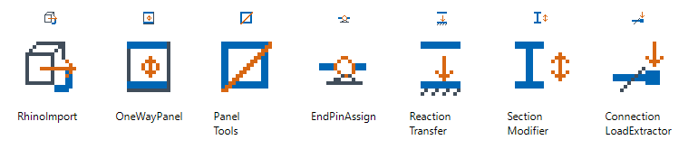
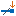

# Nextra AxisVM toolbox: user guide

Choose a tool by the task you want to perform. Select objects in AxisVM before opening its dialog.

[Install the toolbox](../INSTALLATION.md) ? [Build from source](../HOW-TO-BUILD.md)

| Tool | Use it for |
|---|---|
|  [Rhino import](rhino-import.md) | Bring an AxisBridge JSON export from Rhino into the active AxisVM model. |
|  [One-way load panels](one-way-panels.md) | Choose how a panel spans and which beams receive its load. |
|  [Load panel tools](panel-tools.md) | Convert panels and domains, split panels, or merge adjacent panels. |
|  [End pin assign](end-pins.md) | Apply rotational hinges or semi-rigid releases at the free ends of selected chains. |
|  [Reaction transfer](reaction-transfer.md) | Transfer selected support reactions into a target model as nodal point loads. |
|  [Section modifier](section-modifier.md) | Set the width and/or depth of rectangular member sections. |
|  [Connection load extractor](connection-loads.md) | Find critical member-end loads and keep the full concurrent force/moment vector. |

A menu entry marked **(WIP)** is a tool still in development. All seven tools are currently released without the label.
