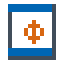
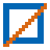
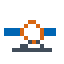
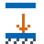
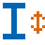
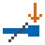

# Nextra AxisVM toolbox: user guide

Choose a tool by the task you want to perform. Select objects in AxisVM before opening its dialog.

[Install the toolbox](../INSTALLATION.md) | [Add a tool](../ADDING-A-TOOL.md) | [Build from source](../HOW-TO-BUILD.md)

<!-- gen:tools-guide -->
| | Tool | Use it for |
|---|---|---|
|  | [Rhino import](rhino-import.md) | Import AxisBridge JSON geometry and structural attributes. |
|  | [One-way load panels](one-way-panels.md) | Convert panels or create them from lines; choose span and edge strips. |
|  | [Load panel tools](panel-tools.md) | Convert panel/domain, split, and merge panels. |
|  | [End pin assign](end-pins.md) | Apply hinges and semi-rigid end releases. |
|  | [Reaction transfer](reaction-transfer.md) | Turn support reactions into point loads in a target model. |
|  | [Section modifier](section-modifier.md) | Set rectangular section width and depth. |
|  | [Connection loads](connection-loads.md) | Extract concurrent forces and moments for governing combinations. |
<!-- /gen:tools-guide -->

A menu entry marked **(WIP)** is a tool still in development. Released tools carry no label.
