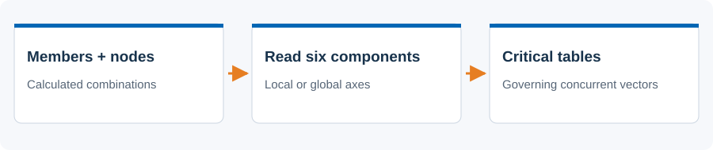
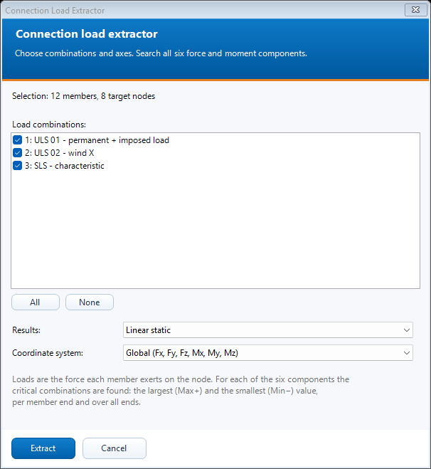

# Connection load extractor

 Find critical member-end loads and keep the full concurrent force/moment vector.

## Steps

1. Calculate the load combinations. Select the beams/ribs, optionally also the nodes whose member ends you need. With no selected nodes, both ends are included.
2. Open N. Connection Load Extractor (WIP), tick the combinations and choose linear/non-linear results and local/global axes.
3. Press Extract. Read Summary, the six component tabs, All and Checks. Each critical row includes its combination and concurrent six-component vector.
4. Use Export all or Export critical for CSV, Copy tab for TSV, or Select in model to highlight the rows. The result window stays open while you inspect AxisVM.

## Dialog

The screenshot is an offline preview with synthetic inputs. It is not a model-analysis result.

## Existing behavior to know

The reported loads are the forces each member exerts on its end node. Critical Max+/Min- values are searched independently for every component; concurrent values come from the same governing combination. Extraction does not edit geometry or loads. Select in model replaces the current selection. Inspect Checks for missing results, frame warnings and sign checks.

[Detailed implementation notes](../addons/ConnectionLoadExtractorAddon.md) ? [All tools](README.md) ? [Installation](../INSTALLATION.md)
