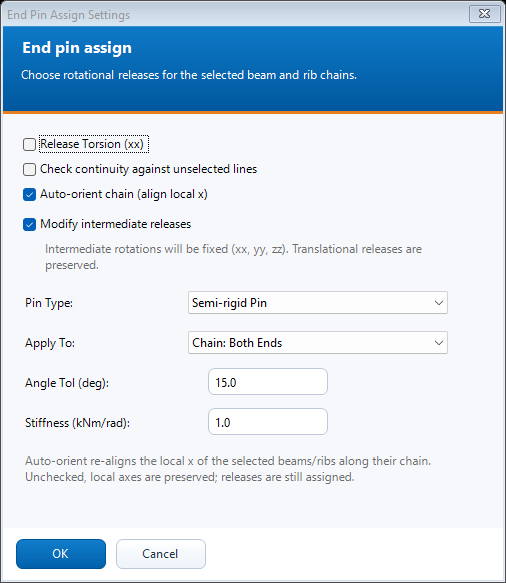

# End pin assign

 Apply rotational hinges or semi-rigid releases at the free ends of selected chains.

## Steps

1. Select the beam or rib chains, then open N. End Pin Assign (WIP).
2. Choose Complete Pin or Semi-rigid Pin. For semi-rigid pins, enter the rotational stiffness in kNm/rad.
3. Choose both chain ends, the chain start or the chain end. Enter the continuity angle tolerance.
4. Review **Modify intermediate releases** (enabled by default). Enabled: every selected beam/rib is first made fully fixed at both ends, then only the chosen chain ends get the pin. Disabled: existing releases are kept (pins stay pins) and only the chosen chain ends are added or changed.
5. Review Auto-orient, continuity against unselected lines and torsion release. Press OK and inspect the summary.

## Dialog

The screenshot is an offline preview with synthetic inputs. It is not a model-analysis result.

## Existing behavior to know

Auto-orient is enabled by default and realigns selected beam/rib local x axes. Disabling it preserves local axes. Torsion is released at most once per chain. Existing translational releases are preserved. Branched and closed-loop selections cannot always define a unique start/end.

With modification enabled the reset covers the whole selection, including intermediate joints, the untargeted end for Start/End Node Only, and ends excluded by the model-continuity check. Unselected lines are never changed. The summary reports how many line ends were reset to fixed.

[Detailed implementation notes](../addons/EndPinAssignAddon.md) ? [All tools](README.md) ? [Installation](../INSTALLATION.md)
