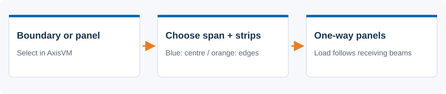
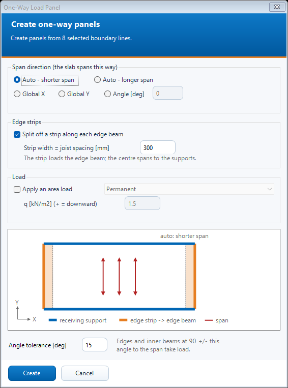

# One-way load panels

 Choose how a panel spans and which beams receive its load.

## Steps

1. Select existing load panels to convert, or select closed boundary lines to create new panels. Open N. One-Way Load Panel.
2. Choose Auto - shorter span, Auto - longer span, Global X/Y, or an explicit angle. Auto follows the bay edges, including rotated bays.
3. Choose whether to split edge strips and enter their width in millimetres. Check the diagram: blue supports receive the centre load; orange edge beams receive the strips.
4. Set the angle tolerance for receiving members. When creating panels, optionally choose a load case and enter the area load. Press Create or Convert and read the report.

## Dialog

The screenshot is an offline preview with synthetic inputs. It is not a model-analysis result.

## Existing behavior to know

The direction is the span direction. Receiving beams run at 90 degrees plus/minus the tolerance to it, including eligible interior beams. Edge strips require a suitable four-sided bay; unsupported shapes are reported or fall back according to the existing builder. Positive area load in the dialog means downward.

[Detailed implementation notes](../addons/OneWayLoadPanelAddon.md) ? [All tools](README.md) ? [Installation](../INSTALLATION.md)
