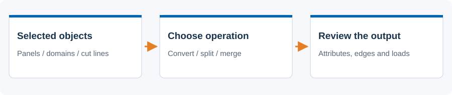
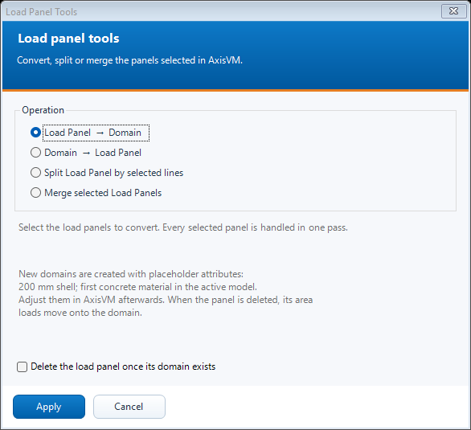

# Load panel tools

 Convert panels and domains, split panels, or merge adjacent panels.

## Steps

1. Select the objects in AxisVM before opening N. Load Panel Tools.
2. Choose Load Panel to Domain, Domain to Load Panel, Split, or Merge. Read the selection hint: splitting needs both panels and cutting lines.
3. For conversion, choose whether to delete the original. Splitting and merging replace the source panels automatically.
4. Press Apply and review the summary, including any skipped panels or load-transfer limitations.

## Dialog

The screenshot is an offline preview with synthetic inputs. It is not a model-analysis result.

## Existing behavior to know

Panel-to-domain uses placeholder thickness/material attributes shown in the dialog; adjust them afterwards. Split lines must already end on the contour. Merge requires coplanar panels sharing contour lines, compatible Auto settings and matching loads. Shared interior edges stop receiving panel load; their geometry remains. Deleting a domain removes its loads.

[Detailed implementation notes](../addons/LoadPanelToolsAddon.md) ? [All tools](README.md) ? [Installation](../INSTALLATION.md)
