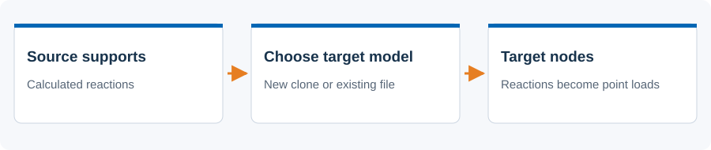
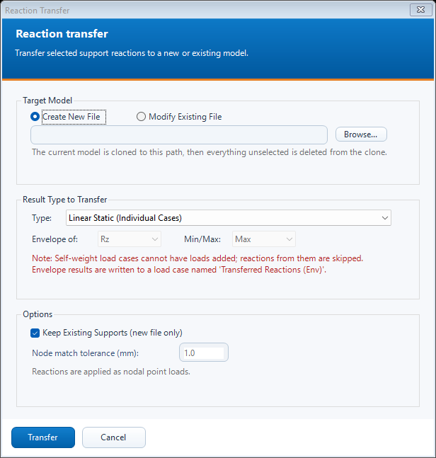

# Reaction transfer

 Transfer selected support reactions into a target model as nodal point loads.

## Steps

1. Save and calculate the source model. Select the supports/nodes and geometry needed in the target.
2. Open N. Reaction Transfer (WIP). Choose Create New File or Modify Existing File, then Browse for the target path.
3. Choose linear, non-linear or envelope results. For envelopes, choose a component and Min/Max.
4. For a new file choose whether to keep supports. For an existing file set the node-match tolerance. Press Transfer and review the confirmation and report.

## Dialog

The screenshot is an offline preview with synthetic inputs. It is not a model-analysis result.

## Existing behavior to know

A new file starts as a clone and is trimmed to the selection. Existing-file mode backs up the target and adds reactions without trimming it; AxisVM finishes with the target open. The source is saved first. Self-weight load cases are skipped. Reactions retain their read sign; envelope loads use Transferred Reactions (Env).

[Detailed implementation notes](../addons/ReactionTransferAddon.md) ? [All tools](README.md) ? [Installation](../INSTALLATION.md)
