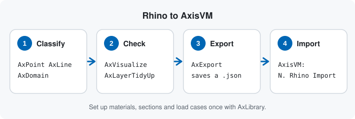
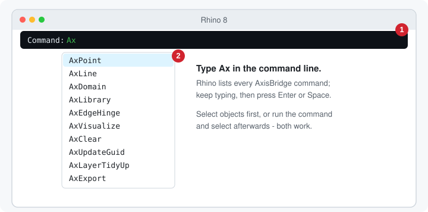
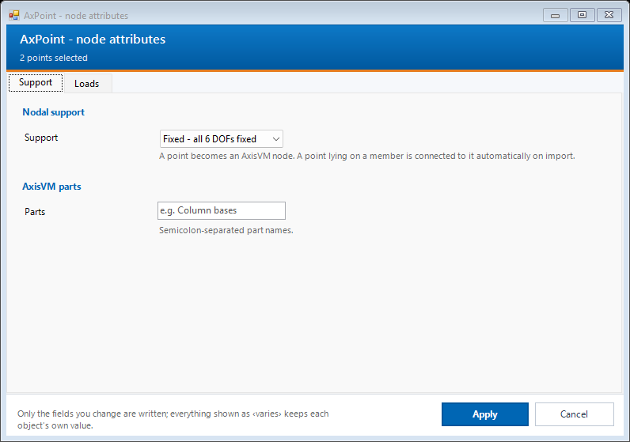
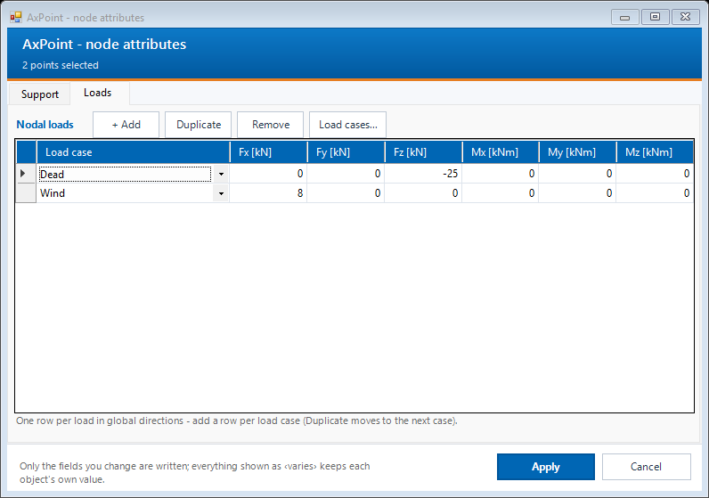
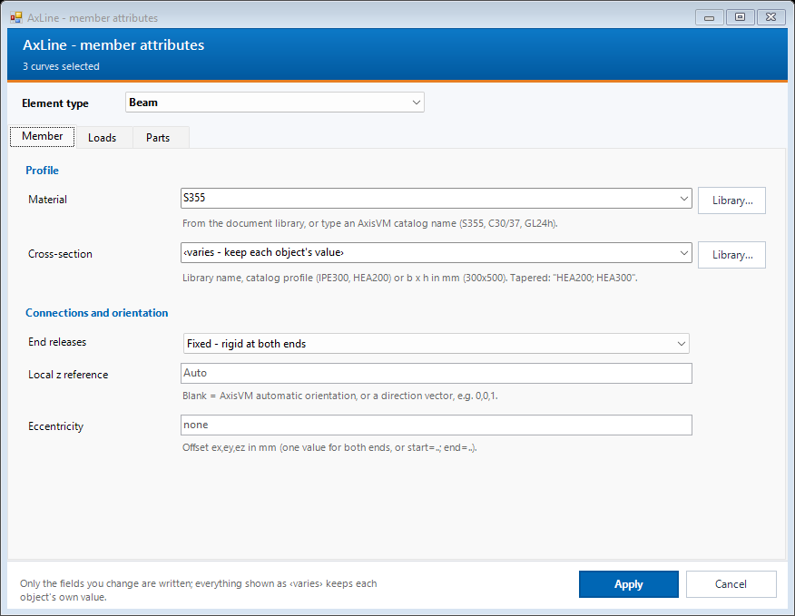
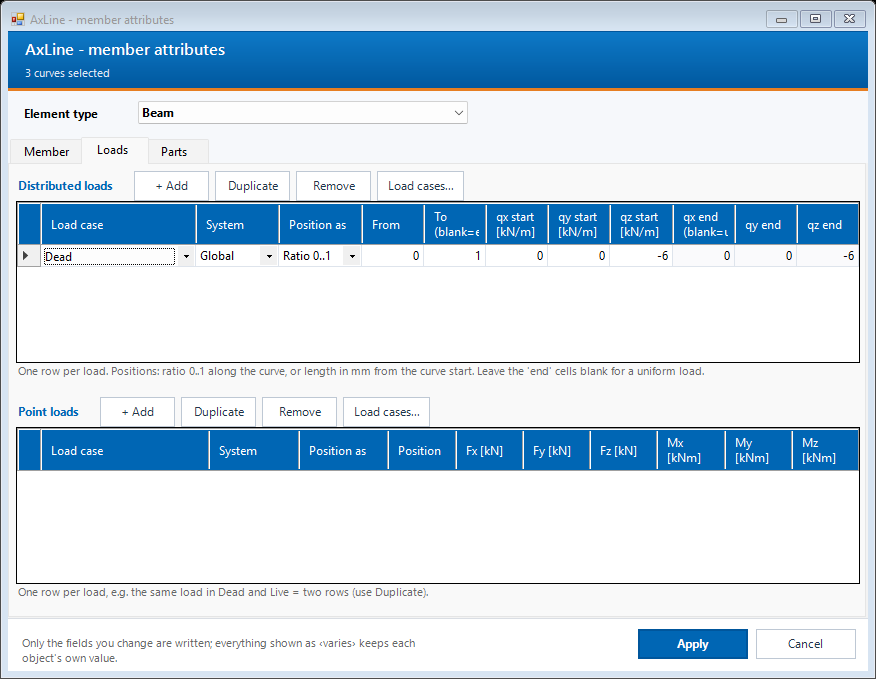
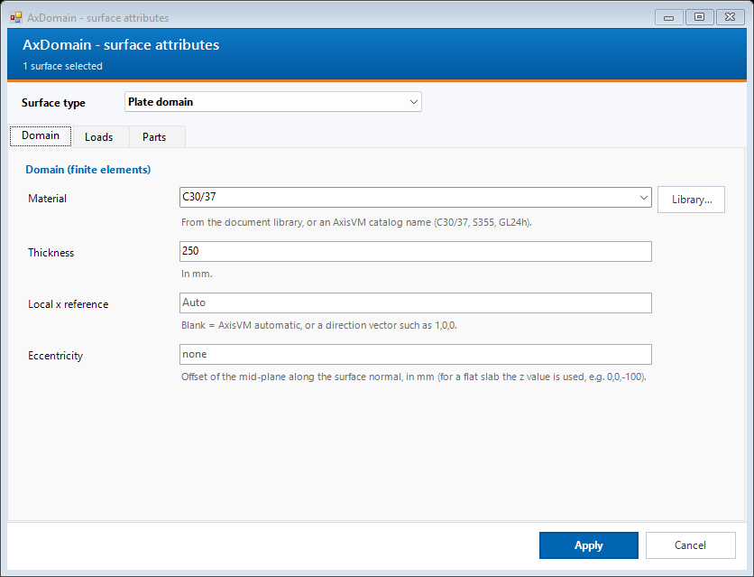
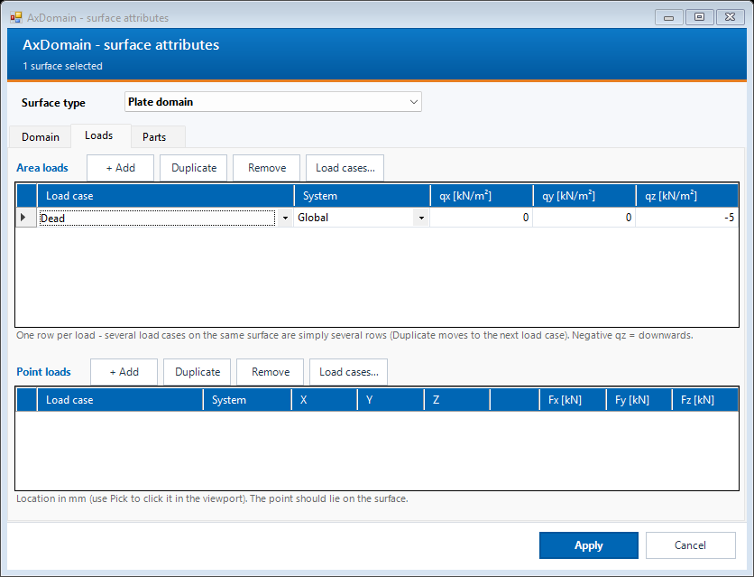
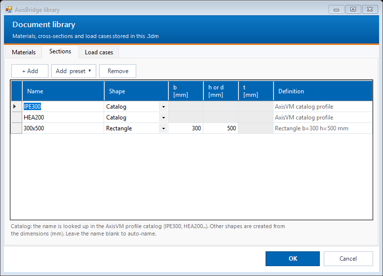
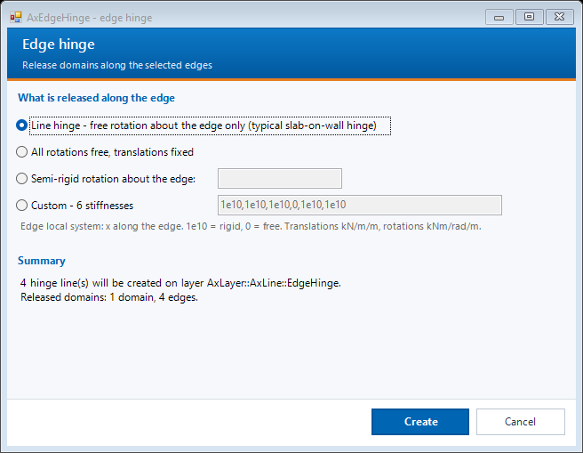

# Rhino commands (Nextra-AxisRhinoImport)

The Rhino plug-in adds ten commands that all start with `Ax`. You tag Rhino geometry with structural attributes, check the result, export a JSON file, and read it into AxisVM with [N. Rhino Import](rhino-import.md). Install the plug-in first: [Installation](../INSTALLATION.md#3-rhino-plug-in-nextra-axisrhinoimport).

## Using the commands

1. Click Rhino's command line and type `Ax`. Rhino lists all AxisBridge commands. Finish the name and press Enter or Space.
2. For the three attribute commands (`AxPoint`, `AxLine`, `AxDomain`) you can select objects first or after starting the command. Press Enter to open the dialog.
3. Set only what you need and press **Apply**. Fields you do not touch stay as they were.
4. With several objects selected, a field that differs between them shows **‹varies›**. Leave it alone to keep each object's own value; type a value to set it on all of them.

| Command | Select | What it does |
|---|---|---|
| `AxPoint` | points | Nodal support, nodal loads, parts. |
| `AxLine` | curves | Beam, rib, truss, spring, rigid link, node link, edge hinge or simple line, with material, section, releases and loads. |
| `AxDomain` | surfaces | Shell, plate or membrane domain, load panel or one-way load panel, with thickness and loads. |
| `AxLibrary` | nothing | Document library of materials, sections and load cases, stored in the .3dm file. |
| `AxEdgeHinge` | edges, then domains | Creates hinge lines along edges and releases the chosen domains there. |
| `AxVisualize` | nothing | Toggles text-dot tags that show every attribute. Run again to remove them. |
| `AxClear` | any objects | Removes all `Ax_*` attributes from the selected objects. |
| `AxUpdateGuid` | nothing (whole file) | Gives copied objects a fresh `Ax_Guid` so duplicates do not share an id. |
| `AxLayerTidyUp` | nothing (whole file) | Moves tagged objects into the layer tree `AxLayer :: AxLine / AxDomain / AxLoadPanel / AxPoint :: type`. |
| `AxExport` | optional | Writes the JSON file for AxisVM. |

## AxPoint: nodes

Select points and run `AxPoint`. The **Support** tab sets the nodal support (fixed, pinned and other support types) and part names. The **Loads** tab has one row per nodal load in global directions; add a row per load case. A point that lies on a member is connected to it automatically on import.

## AxLine: members

Select curves and run `AxLine`. Choose the **Element type** in the strip under the header; the tabs below change with the type.

- **Member:** material and cross-section (pick from the library with **Library...**, type an AxisVM catalog name such as `S355`, `IPE300`, or a size such as `300x500`), end releases, local z reference and eccentricity.
- **Spring / link** and **Support** appear for the types that use them.
- **Loads:** point and distributed member loads, one row per load, with load case, axis system and position (ratio 0..1 or length).
- **Parts:** semicolon-separated part names.

## AxDomain: surfaces

Select surfaces and run `AxDomain`. Choose the **Surface type** (shell, plate, membrane, load panel, one-way load panel). The **Domain** tab sets material, thickness, local x reference and eccentricity. Load panel types add a **Load panel** tab for the span direction and edge strips, with a preview in the viewport. **Loads** holds area loads and point loads.

## AxLibrary: materials, sections, load cases

`AxLibrary` opens the document library. Elements refer to these names, so set it up once per file. **Add preset** inserts common materials and sections; **Remove** deletes the selected rows. Names are looked up in the AxisVM catalog when the file is imported.

The **Materials** and **Load cases** tabs work the same way.

## AxEdgeHinge: hinges along edges

1. Run `AxEdgeHinge` and select the edges (surface edges or curves). Press Enter.
2. Select the domains to release along those edges, or press Enter for all domains along them.
3. Choose what is released: a line hinge about the edge only, all rotations, a semi-rigid rotation (enter the stiffness in kNm/rad/m), or a custom set of six stiffnesses.
4. Press **Create**. Each edge becomes a new curve on `AxLayer::AxLine::EdgeHinge`. Edit it later with `AxLine`.

## Check, clean up, export

- **`AxVisualize`** adds a tag on each tagged object so you can see supports, sections and loads at a glance. Hide groups with the `AxTag` child layers. Tags are never exported. Run it again to remove them.
- **`AxLayerTidyUp`** sorts tagged objects into tidy layers without changing their attributes.
- **`AxUpdateGuid`** is for copied or pasted members. Run it before exporting a model that was built by copying.
- **`AxExport`** first shows two options in the command line: **Scope** (`All` or `OnlySelected`; selected objects are the default when something is selected) and **Untagged** (`Skip` or `Include`, which exports untagged geometry as plain geometry). Press Enter, choose where to save the JSON file, and read the summary: counts of points, members and surfaces, plus any warnings.

Then open **N. Rhino Import** in AxisVM and choose the file; see [Rhino import](rhino-import.md).

## Notes

- The pictures are rendered offline from the real dialogs with example data (`scripts/Preview-RhinoUI.ps1`). They show no real model.
- Load values entered in these dialogs are in kN-based units (kN, kNm, kN/m).
- Attribute keys (`Ax_Type`, `Ax_Section`, ...) are plain Rhino user strings, so they also survive copy, paste and file exchange.

[All tools](README.md) | [Rhino import](rhino-import.md) | [Installation](../INSTALLATION.md)
