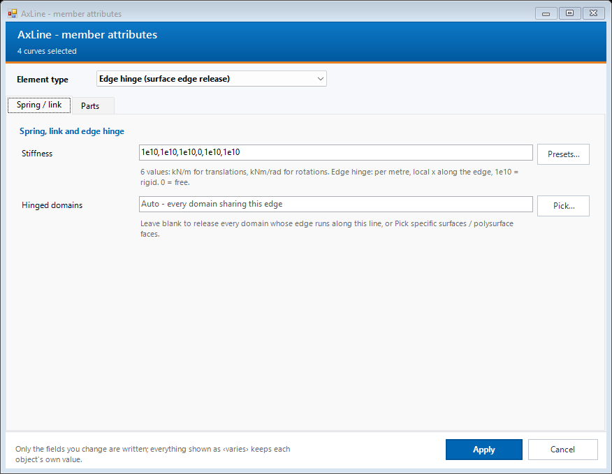

# Rhino commands (Nextra-AxisRhinoImport)

The Rhino plug-in adds ten commands that all start with `Ax`. You tag Rhino geometry with structural attributes, check the result, export a JSON file, and read it into AxisVM with [N. Rhino Import](rhino-import.md). Install the plug-in first: [Installation](../INSTALLATION.md#3-rhino-plug-in-nextra-axisrhinoimport).

## Using the commands

1. Click Rhino's command line and type `Ax`. Rhino lists all AxisBridge commands. Finish the name and press Enter or Space.
2. For the three attribute commands (`AxPoint`, `AxLine`, `AxDomain`) you can select objects first or after starting the command. Press Enter to open the dialog.
3. Set only what you need and press **Apply**. Fields you do not touch stay as they were.
4. With several objects selected, a field that differs between them shows **‹varies›**. Leave it alone to keep each object's own value; type a value to set it on all of them.

| Command | Select | What it does |
|---|---|---|
| `AxPoint` | points | Nodal support, nodal loads, parts. |
| `AxLine` | curves, or surface / mesh edges | Beam, rib, truss, spring, rigid link, node link, edge hinge or simple line, with material, section, releases and loads. |
| `AxDomain` | surfaces | Shell, plate or membrane domain, load panel or one-way load panel, with thickness and loads. |
| `AxLibrary` | nothing | Document library of materials, sections and load cases, stored in the .3dm file. |
| `AxVisualize` | nothing | Opens the AxVisualize window and draws supports, releases, load arrows and element info in the viewports. Run again or close the window to turn it off. |
| `AxClear` | any objects | Removes all `Ax_*` attributes from the selected objects. |
| `AxUpdateGuid` | nothing (whole file) | Gives copied objects a fresh `Ax_Guid` so duplicates do not share an id. |
| `AxLayerTidyUp` | nothing (whole file) | Moves tagged objects into the layer tree `AxLayer :: Members / Domains / LoadPanels / Nodes :: type :: property`. |
| `AxExport` | optional | Writes the JSON file for AxisVM. |

## AxPoint: nodes

Select points and run `AxPoint`. The **Support** tab sets the nodal support (fixed, pinned and other support types) and part names. The **Loads** tab has one row per nodal load in global directions; add a row per load case. A point that lies on a member is connected to it automatically on import.

## AxLine: members

Select curves and run `AxLine`. You can also select surface, polysurface or mesh edges: each edge is copied to a new curve on `AxLayer::Members::EdgeHinge`, typed as an edge hinge (the slab itself is not changed). Cancelling the dialog removes those copies again. Choose the **Element type** in the strip under the header; the tabs below change with the type.

- **Member:** material and cross-section (pick from the library with **Library...**, type an AxisVM catalog name such as `S355`, `IPE300`, or a size such as `300x500`), end releases, local z reference and eccentricity.
- **Spring / link** and **Support** appear for the types that use them.
- **Loads:** point and distributed member loads, one row per load, with load case, axis system and position (ratio 0..1 or length).
- **Parts:** semicolon-separated part names.

## AxDomain: surfaces

Select surfaces and run `AxDomain`. Meshes work too: on export each flat region of the mesh becomes one domain (its outline and openings), and AxisVM meshes it again. A curved mesh gives many small domains, so use flat meshes. Choose the **Surface type** (shell, plate, membrane, load panel, one-way load panel). The **Domain** tab sets material, thickness, local x reference and eccentricity. Load panel types add a **Load panel** tab for the span direction and edge strips, with a preview in the viewport. **Loads** holds area loads and point loads.

## AxLibrary: materials, sections, load cases

`AxLibrary` opens the document library. Elements refer to these names, so set it up once per file. **Add preset** inserts common materials and sections; **Remove** deletes the selected rows. Names are looked up in the AxisVM catalog when the file is imported.

The **Materials** and **Load cases** tabs work the same way.

**From AxisVM catalog...** (Materials and Sections tabs) lists every Eurocode material and every AxisVM cross-section table, grouped as in AxisVM: code > type > kind for materials, shape > table for sections. Search ignores spaces and case (`hea300` finds `HEA 300`). Tick entries and press **Add to library**; only what you add appears in the AxLine / AxDomain dropdowns. Names are kept exactly as AxisVM spells them, and on import each section comes from the table it was picked from, even where another table has a profile with the same name.

The list comes from AxisVM. Once per computer (and again after an AxisVM update), open **Rhino Import** in AxisVM and click **Export catalog for Rhino**. It writes `AxisVM-materials.csv` and `AxisVM-sections.csv` to `%APPDATA%\AxisBridge` (`C:\Users\<you>\AppData\Roaming\AxisBridge`). Both programs find that folder on their own, whatever the user name or install location.

### Edge hinges

1. Run `AxLine` and select the slab or wall edges (or existing curves). Press Enter.
2. Set **Element type** to edge hinge (already set for picked edges).
3. On the **Spring / link** tab, set **Stiffness**: six values per metre of edge in the edge's local system (x along the edge), `1e10` = rigid, `0` = free. **Presets...** offers a line hinge about the edge only, all rotations free, or a semi-rigid rotation about the edge (then edit the fourth value, in kNm/rad/m).
4. **Hinged domains**: leave blank to release every domain along the edge, or press **Pick...** and select the domains to release. A single face of a polysurface, or a flat region of a mesh, may be picked.

## Check, clean up, export

- **`AxVisualize`** opens a small window and draws the model's attributes in the viewports: one label per element (type, section, material), support symbols (sphere = pinned, block = fixed, ball on a plate = roller, orange = custom stiffness), release markers near each member end (red = released, orange = semi-rigid), span arrows on one-way panels, and the load arrows of the load case you pick (one case at a time, arrow length scales with the value). Tick element types under **Elements** (Beam, Plate, Node, ...) to show only those, use the check boxes to choose what is shown and the sliders to size symbols and arrows. Symbols, arrows and text have a fixed size in the model, like real geometry: they get smaller when you zoom out and larger when you zoom in (text too small to read is hidden); line loads are drawn as closed load diagrams. It is display only: nothing is added to the model, nothing can be selected, and nothing is exported. Local loads use a simplified member frame (x along the member, z up). Close the window or run `AxVisualize` again to turn it off. Files with the old text-dot tags (`AxTag` layers) are cleaned up automatically.
- **`AxLayerTidyUp`** sorts tagged objects into tidy layers without changing their attributes: one layer per element type and, under it, one per defining property. Beams, ribs and trusses are split by section and material (`Members::Beam::IPE 300 · S 355`), domains by material and thickness (`Domains::Plate::C30-37 · t=200`), load panels into `LoadPanels::OneWay` / `TwoWay`, line supports (`Simple`) and nodes by support kind (`Nodes::Support · Pinned`, `NodalLoad`). Springs, links and hinges get one layer per type. `/` in names becomes `-`. Layers under `AxLayer` that end up empty (for example from older runs) are removed.
- **`AxUpdateGuid`** is for copied or pasted members. Run it before exporting a model that was built by copying.
- **`AxExport`** first shows two options in the command line: **Scope** (`All` or `OnlySelected`; selected objects are the default when something is selected) and **Untagged** (`Skip` or `Include`, which exports untagged geometry as plain geometry). Press Enter, choose where to save the JSON file, and read the summary: counts of points, members and surfaces, plus any warnings.

Then open **N. Rhino Import** in AxisVM and choose the file; see [Rhino import](rhino-import.md).

## Notes

- The pictures are rendered offline from the real dialogs with example data (`scripts/Preview-RhinoUI.ps1`). They show no real model.
- Load values entered in these dialogs are in kN-based units (kN, kNm, kN/m).
- Attribute keys (`Ax_Type`, `Ax_Section`, ...) are plain Rhino user strings, so they also survive copy, paste and file exchange.

[All tools](README.md) | [Rhino import](rhino-import.md) | [Installation](../INSTALLATION.md)
