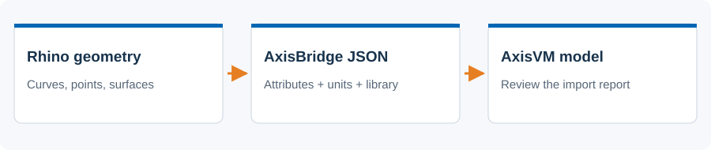
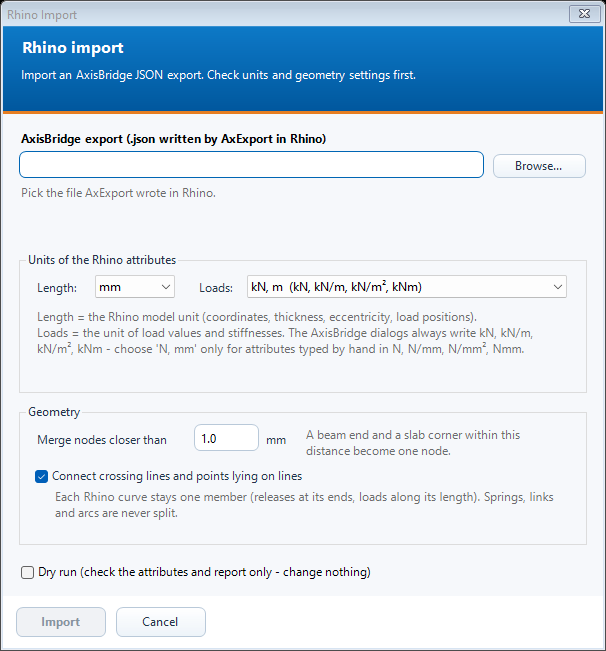

# Rhino import

 Bring an AxisBridge JSON export from Rhino into the active AxisVM model.

## Steps

1. In Rhino, use AxPoint, AxLine and AxDomain to classify geometry and set its structural attributes. Use AxLibrary for document materials, sections and load cases.
2. Run AxExport and save the JSON file. Open N. Rhino Import in AxisVM and choose that file.
3. Check the file summary, length/load units and node merge tolerance. Leave crossing-line connection enabled when it suits the geometry.
4. Use Dry run first to inspect attribute problems without writing to the model. Then run Import and review the complete report.

See the [Rhino commands guide](rhino-commands.md) for every Ax command with screenshots.

## Dialog

The screenshot is an offline preview with synthetic inputs. It is not a model-analysis result.

## Existing behavior to know

Coordinates and attributes are interpreted using the chosen units. AxisBridge dialogs write load attributes in kN-based units; choose N, mm only for manually entered attributes in those units. This dialog has no overwrite/replace mode: inspect the report after a repeat import.

[Detailed implementation notes](../addons/RhinoImportAddon.md) ? [All tools](README.md) ? [Installation](../INSTALLATION.md)
