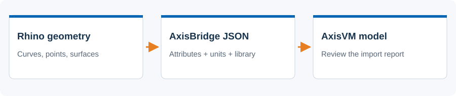
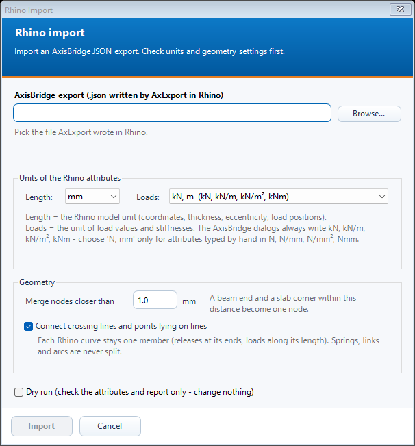

# Rhino import

 Bring an AxisBridge JSON export from Rhino into the active AxisVM model.

## Steps

1. In Rhino, use AxPoint, AxLine and AxDomain to classify geometry and set its structural attributes. Use AxLibrary for document materials, sections and load cases.
2. Run AxLink and **Send to AxisVM** (or AxExport for a one-off file). Open N. Rhino Import in AxisVM and choose the same file.
3. Check the file summary, length/load units and node merge tolerance. Leave crossing-line connection enabled when it suits the geometry.
4. Use Dry run first to inspect attribute problems without writing to the model. Then **Load from Rhino** and review the report.
5. After changes in Rhino, send again and load again: with **Only apply what changed** (on by default) AxisVM rebuilds just
   what you changed and keeps the rest, including hinges, supports and meshes made in AxisVM.
6. Changes made in AxisVM go back with **To Rhino › Send to Rhino**; in Rhino, AxLink › Load from AxisVM.

See the [Rhino commands guide](rhino-commands.md) for every Ax command with screenshots.

## Dialog

The screenshot is an offline preview with synthetic inputs. It is not a model-analysis result.

**Export catalog for Rhino** writes this AxisVM's Eurocode materials and cross-section tables to `%APPDATA%\AxisBridge`, for *AxLibrary > From AxisVM catalog* in Rhino. It only reads the catalog; the model is not changed. Run it once per computer and again after an AxisVM update.

## Existing behavior to know

Coordinates and attributes are interpreted using the chosen units. AxisBridge dialogs write load attributes in kN-based units; choose N, mm only for manually entered attributes in those units. Changing the units or the merge tolerance makes the next load replace everything.

[How the link works, every element, limits](../reference/rhino-axisvm-link.md) · [Detailed implementation notes](../addons/RhinoImportAddon.md) ? [All tools](README.md) ? [Installation](../INSTALLATION.md)
