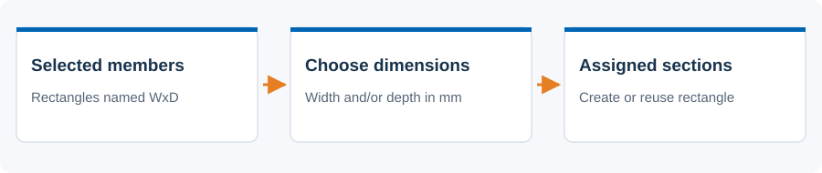
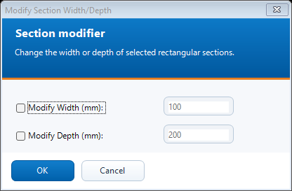

# Section modifier

 Set the width and/or depth of rectangular member sections.

## Steps

1. Select the target beam, rib or truss lines, or their members.
2. Open N. Section Modifier. Tick Modify Width and/or Modify Depth.
3. Enter the new dimension in millimetres. An unticked dimension is retained according to the existing section-name convention.
4. Press OK and review the modified count. Inspect the assigned sections in AxisVM.

## Dialog

The screenshot is an offline preview with synthetic inputs. It is not a model-analysis result.

## Existing behavior to know

This tool creates or reuses rectangular sections named WxD, such as 100x200. The unchanged engine reads the retained dimension from that name; if it cannot parse it, it uses a 100 mm fallback. It does not select the next IPE/HEA profile or edit arbitrary section shapes. Use it only with the intended rectangular-section convention.

[Detailed implementation notes](../addons/SectionModifierAddon.md) ? [All tools](README.md) ? [Installation](../INSTALLATION.md)
