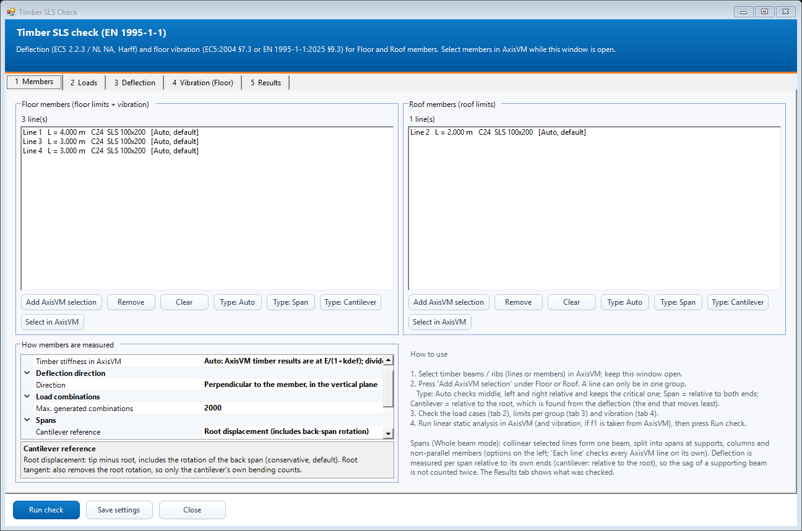
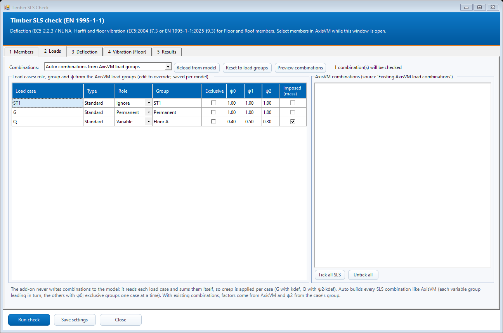
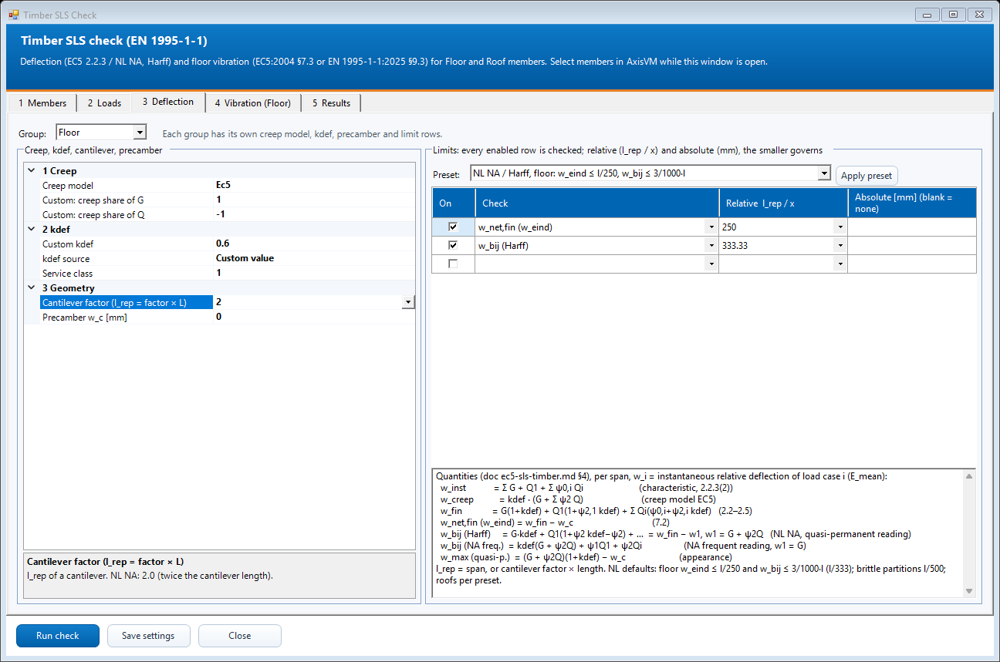
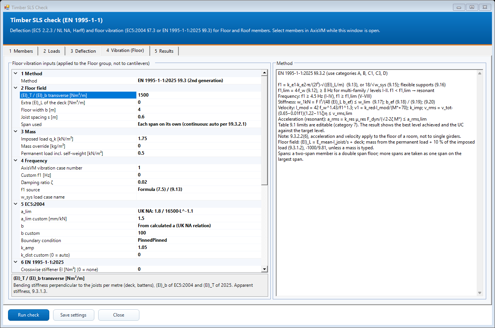
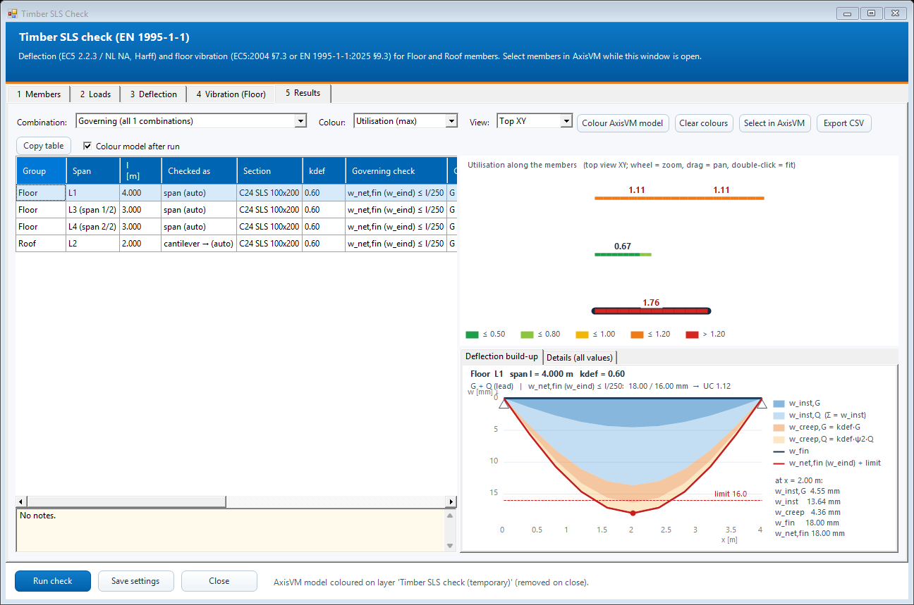
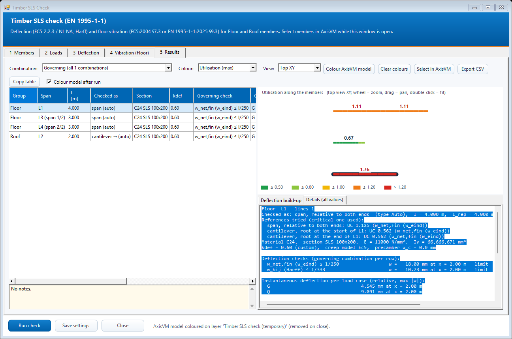

# Timber SLS check

 Checks the deflection of timber beams and joists to EN 1995-1-1 (with the NL NA / Harff method as default), and the vibration of timber floors to EN 1995-1-1:2004 §7.3 or EN 1995-1-1:2025 §9.3. Floor and roof members are checked in one run, each with their own limits.

The formulas, defaults and sources are in the [EC5 SLS specification](../reference/ec5-sls-timber.md).

## Steps

1. Run a **linear static analysis** in AxisVM. For f1 from AxisVM, also run a vibration analysis.
2. Open **N. Timber SLS Check (WIP)**. The window is modeless, so you can keep selecting in AxisVM while it is open.
3. **1 Members**: select timber beams or ribs (lines or members) in AxisVM, then press **Add AxisVM selection** under *Floor* or *Roof*. To fix how a member is measured, select it in the list and press **Type: Auto / Span / Cantilever** (see below).
4. **2 Loads**: check the role (permanent / variable / ignore), group and ψ factors of each load case. They are read from the AxisVM load groups, and you can type over them. Choose the combination source:
   - *Auto* builds every SLS combination from the load groups.
   - *Existing AxisVM combinations* uses the combinations you tick.
   - *Manual* uses the roles and ψ factors in the table.
5. **3 Deflection**: per group, choose the creep model and the kdef source, and set the cantilever factor and precamber. Then pick a limit preset (NL NA / Harff, EC5 Table 7.2, AxisVM style) or type your own rows. Each row takes a relative limit (l/x), an absolute limit (mm) or both.
6. **4 Vibration (Floor)**: choose EN 1995-1-1:2004 §7.3 or EN 1995-1-1:2025 §9.3 and fill in the floor field: width, joist spacing, transverse stiffness and loads for the mass. Every value has a dropdown of standard values and also accepts any typed value.
7. Press **Run check**. The Results tab opens and the AxisVM model is coloured by utilisation on a temporary drawing layer. The layer is removed when the window closes, or with **Clear colours**.

## How a member is measured

- **Span mode**:
  - *Whole beam* (default): collinear selected lines form one beam, split into spans at supports, at columns and (option) at non-parallel connecting members.
  - *Each line*: every AxisVM line is checked on its own.
- **Type**:
  - *Auto* (default) checks every span three ways: relative to both ends (middle), relative to the left end and relative to the right end (cantilever, l_rep = factor × L). The critical one is used, and the Results tab shows which one (*Checked as*) together with all three utilisations (*Details*).
  - *Span* forces the middle check.
  - *Cantilever* forces a cantilever check, with the root found from the deflection: the end that moves least.
- **AxisVM stiffness**: AxisVM analyses timber with E_mean/(1+kdef). The add-on divides the displacements by (1 + kdef of the line) to get the instantaneous deflection, then applies creep per load case. You can switch this off on the Members tab.

## Load cases and limits

## Vibration

## Results

- **Table**: one row per span, showing what was checked, the governing check, the combination, w, the limit, the deflection and vibration utilisations, and the status. Click a row, or a member in the view.
- **View**: members coloured by local utilisation along their length. Wheel zooms, drag pans, double-click fits.
- **Deflection build-up**: w_inst,G + w_inst,Q + w_creep,G + w_creep,Q (EC5 fig. 7.1), the precamber, the checked quantity and its limit.
- **Details**: every intermediate value, including the full vibration chain.
- **Combination**: *Governing*, or any single combination.
- **Export report**: saves a self-contained HTML calculation report and opens it. It holds the summary table, the coloured member plan, the basis of the check (standards, creep model, kdef, limits per group, vibration inputs), the load cases with ψ factors, every span with its deflection build-up diagram and all values, the notes, and the list of combinations. Print it to PDF from the browser.
- **Export CSV**: one row per span and limit row, with what was checked, kdef and its source, w, x, limit, UC, the governing row, the vibration method, f1, stiffness and response values, the achieved level, the overall UC and the status. **Copy table** copies the same table for Excel.
- **Colour AxisVM model** and **Select in AxisVM**.

The screenshots come from the live check model (Checks/TimberSlsLiveChecks): a 4 m simply supported beam, a 2 m cantilever and a 3 + 3 m two-span beam in C24 100×200, under G = 1 kN/m and Q = 2 kN/m.

[Detailed implementation notes](../addons/TimberSlsAddon.md) | [All tools](README.md) | [Installation](../INSTALLATION.md)
